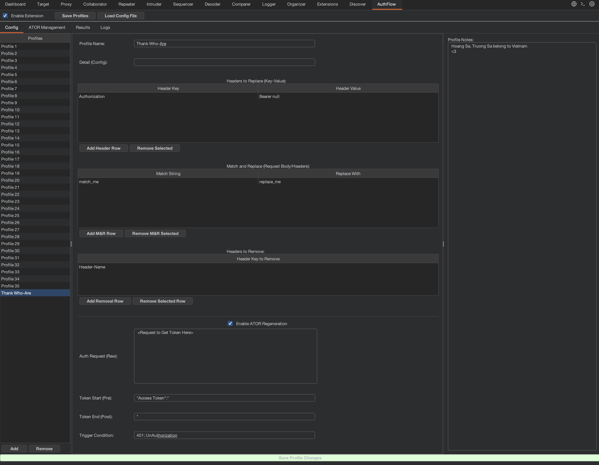
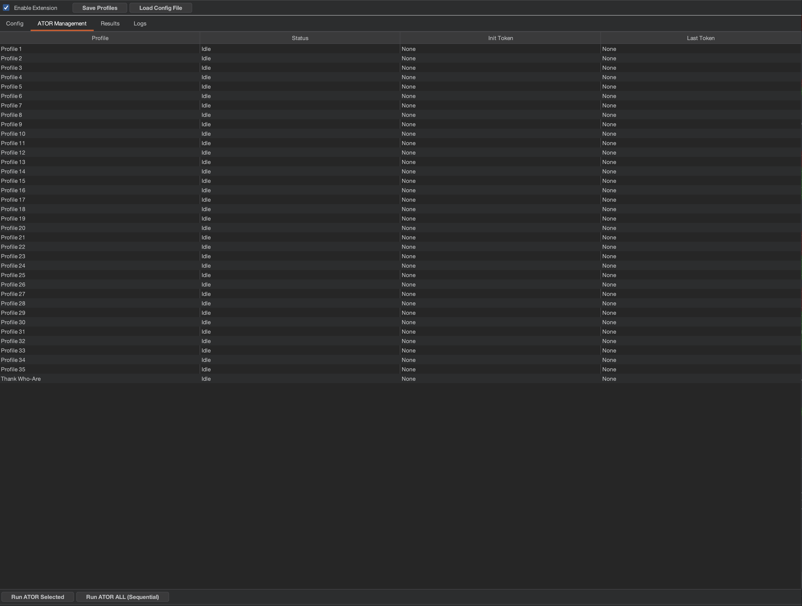
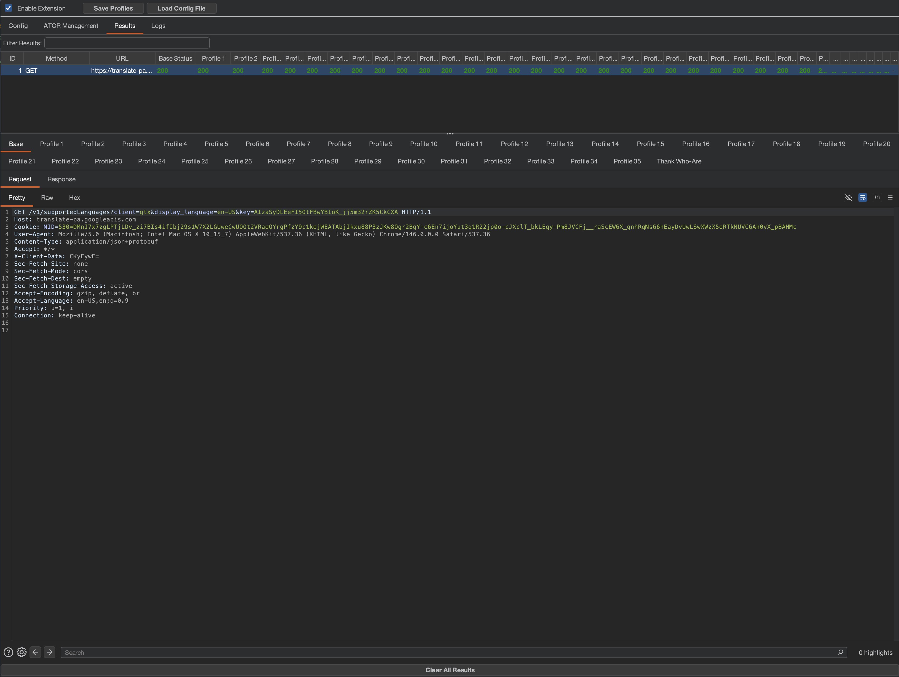

# 🛡️ AuthFlow Analyzer Pro
[](https://portswigger.net/burp)
[-blue?style=flat-square&logo=python)](https://www.python.org/)
[](https://opensource.org/licenses/MIT)

**AuthFlow Analyzer Pro** is a powerful Burp Suite extension designed to streamline the analysis of authentication and authorization flows. It allows security researchers to compare how different user profiles respond to the same requests in real-time and provides an automated engine to handle session expiration and token regeneration.

[Key Features](#-key-features) • [Installation](#-installation) • [Usage Guide](#-usage-guide) • [Contributing](#-contributing)

---

## ✨ Key Features

- **🚀 Multi-Profile Mirroring**: Automatically clone and send intercepted requests through multiple configured profiles (e.g., Admin, User, Guest) to detect IDOR and broken access control.
- **Listener Controls**: Independently enable Proxy, Repeater and Intruder, then run all profiles or only profiles checked in the **Listen** column.
- **Bounded Parallel Workers**: Choose 1, 2, 4, 8 or 16 workers. Different profiles run concurrently; each profile's requests and auth flows stay in order.
- **🔄 Smart ATOR (Automatic Token On Response)**: 
    - **Trigger Engine**: Detects session expiration using custom triggers (Status Code or Body content). Supports multiple triggers separated by `;`.
    - **Per-Profile Regeneration**: Serializes requests and refreshes for the same profile while allowing other profiles to progress independently.
    - **Automatic Persistence**: Seamlessly updates subsequent requests with the fresh credentials and saves them to your config.
    - **Multi-step Auth Flows**: Chain any number of raw requests, extract named variables from responses, and reuse them in later steps or mirrored requests.
- **🛠️ Advanced Request Manipulation**:
    - **Headers to Remove**: Strip specific headers from mirrored requests.
    - **Match & Replace**: Literal replacements for both Headers and Request Bodies, with `${variable_name}` templates in either column.
    - **Profile Notes**: Keep track of specific findings or credentials within each profile.



- **📊 Comparative Analysis View**: A dedicated dashboard to view side-by-side responses, highlighted by status code colors for quick triage.
- **⚙️ ATOR Management Tab**: Monitor regeneration status, initial tokens, and last extracted tokens in real-time. Manually trigger regeneration for specific profiles or all at once.



- **💾 Configuration Persistence**: Save and load your complex testing environments into JSON profiles.
- **Template Requests**: Save an auth step as a reusable template, or capture a request using Burp's **AuthFlow: Save as Template Request** context menu.
- **JSON Results Archives**: Export complete request/response buffers and statuses to timestamped files in `data`, then import them for inspection.
- **🔍 Advanced Filtering**: Search and filter through thousands of results instantly.

## 🛠 Installation

### Prerequisites
1. **Burp Suite** (Community or Professional).
2. **Jython Standalone JAR**: This extension requires Jython to run Python inside Burp.
    - Download it from [Jython.org](https://www.jython.org/download).
    - Configure it in Burp: `Extensions` -> `Extension Settings` -> `Python Environment`.

### Setup
1. Download the `AuthFlowAnalyzer.py` file.
2. In Burp Suite, go to the `Extensions` tab.
3. Click **Add**.
4. Select `Extension type`: **Python**.
5. Select the `AuthFlowAnalyzer.py` file and click **Next**.

## 📖 Usage Guide

### 1. Configure Profiles
- Navigate to the **AuthFlow** tab -> **Config**.
- Add a new Profile (e.g., "Manager-User").
- Select a profile and click **Clone** to copy its settings, auth steps and current variable values into an independent profile. Current editor changes are saved first. Copies get unique names such as `Manager-User (Copy)` and are selected automatically.
- **Headers to Replace**: Add headers to override (e.g., `Authorization`).
- **Headers to Remove**: Add header keys you want to strip (e.g., `Cookie`).
- **Match and Replace**: Define string/regex replacements for the final request.
- **Profile Notes**: Save context-specific information for the current profile.

#### Listener sources and selected profiles

Use **Listen on: Proxy / Repeater / Intruder** in the top toolbar to choose incoming traffic. All three sources and **All profiles** are enabled by default. In **Selected profiles** mode, only profiles checked in the Config table's **Listen** column run. Unchecking every profile stops capture and mirroring in that mode. These selections take effect for newly captured traffic; accepted work can finish. **Enable Extension** remains the master listener switch.

Tool choices, profile mode, worker count and the template library are saved in Burp extension settings. Each profile's **Listen** and ATOR flags, stable ID and auth configuration are saved in the profiles JSON. Older profile files remain supported; cloning creates a new independent ID.

#### Parallel execution and consistent Results

**Workers** controls concurrency from 1 to 16 (default: 4). Requests for different profiles can overlap. Work for the same profile is FIFO, including manual auth runs and auth tests, so a refresh cannot race a second request using that profile's credentials. Authentication steps within one flow always remain sequential. Increasing workers helps when multiple profiles are selected; one profile still runs sequentially.

Each captured request has its own result group and a snapshot of the selected profiles' settings. Results columns use stable profile IDs, and response updates use the original group identity. Renaming, removing, cloning or reloading profiles does not move previous responses into another profile's column. Duplicate display names from imported results receive an ID suffix. A queued request whose profile configuration changed is marked **Config Changed**; an already sent request can finish under its original identity. New auth values are published only if the source profile and its configuration revision are still current.

The worker queue accepts up to 256 waiting jobs. Excess jobs show **Queue Full** and are not sent. The UI capture queue is also limited to 256 requests; overflow is counted in Logs. **Clear All Results** cancels queued result jobs and prevents late responses from restoring cleared rows. An HTTP call already in progress may finish; its pending retry is cancelled. Unloading the extension stops accepting work and cancels queued jobs. Network timeouts remain controlled by Burp.

### 2. Set Up Token Regeneration (ATOR)

1. Optionally add **Initial variables**, such as `username`, `password`, or a starting refresh token. Variable names are case-sensitive: letters, digits and underscores, with no leading digit.
2. Click **Add Step**, name the step, and paste its **Auth Request (Raw)**. Select HTTPS or HTTP; the `Host` header supplies the hostname and optional port, including `[IPv6]:port`.
3. Add response extractors with **Add Variable**. Each step may extract multiple values, or none.
4. Use `${variable_name}` anywhere in a later raw request: path, headers or body. Steps run from left to right; **Move Earlier / Move Later** changes their order.
5. Map the final values in **Headers to Replace**, for example `Authorization` → `Bearer ${AuthorToken}`, or in either column of **Match and Replace**.
6. Click **Save & Run Auth Flow** to save and run manually. **Current variables** shows the successful results. Enable **ATOR Regeneration** to run automatically when a mirrored request first needs an unset variable or matches the configured expiry trigger.

| Method | Selector / Start | End / Regex group | Source |
| --- | --- | --- | --- |
| JSON | `data.token`, `items[0].id`, or JSON Pointer `/data/token` | Unused | Usually Body |
| Delimiters | Exact text before the value (old Token Start / Pre) | Exact text after the value (old Token End / Post) | Body, Headers or Response |
| Regex | Expression with a capture group, e.g. `"token"\s*:\s*"([^"]+)"` | Group number or name; defaults to `1`, `0` returns the full match | Body, Headers or Response |
| Header | Header name, e.g. `X-Auth-Token` or `Set-Cookie` | Unused | Always reads response headers; first matching header |

For cookies, use a regex such as `Set-Cookie:\s*session=([^;\r\n]+)` on **Headers** to extract just the cookie value, then put `Cookie: session=${session}` in the next raw request. Cookies and redirects are not followed automatically; represent subsequent requests explicitly as steps.

Each step defaults to HTTP `200-299`. **Expected status** also accepts `2xx`, `200,302`, mixed ranges/codes, or blank for any status. **Trigger Condition** retains the existing behavior: all non-empty conditions separated by `;` must match the status/response, for example `401;Session Expired`.

Example flow:

```text
Request 1 -> extract token1
Request 2 with ${token1} -> extract token2
Request 3 with ${token1} and ${token2} -> extract AuthorToken
Mirrored request: Authorization: Bearer ${AuthorToken}
```

Load [examples/multi_step_auth.json](examples/multi_step_auth.json) for a complete three-step template, then replace its sample hosts, credentials and extraction paths. Templates insert values literally, so apply any JSON/form/URL escaping required by your target before supplying initial values.

Variables are isolated per profile. Each run starts from initial variables, so stale tokens from a previous run cannot satisfy a missing dependency. A later step may intentionally overwrite an earlier variable. Unknown variables, missing/empty extraction results, unexpected statuses and network failures stop the flow. New values are published and saved only when every step succeeds; a failed run preserves the previous successful values. Automatic regeneration retries the mirrored request once. Changing steps or initial values clears cached values, so run the edited flow again.

Older single-request configs load as one step extracting `AuthorToken` with their existing Pre/Post boundaries. Their automatic Authorization update remains supported. New flows use the explicit mappings above. Saved configurations include initial and current variable values, as well as raw requests.

#### Use a Template Request for authentication

Select an auth step and click **Save Selected as Template**, then give it a unique name. A template keeps the raw request, HTTP/HTTPS choice, expected status and response extractors. Alternatively, right-click a request in Burp and choose **AuthFlow: Save as Template Request**; this captures the request and its protocol.

In a profile, choose **Template Request → Use as New Step**. This adds an editable copy to its auth flow. Set any `${variable}` inputs in **Initial variables** or extract them in an earlier step, then test or use **Save & Run Auth Flow** as usual. Templates do not automatically send requests. Editing a copied step or deleting a template does not change previously configured steps. Saving a profile includes its copied steps; the reusable library itself stays in Burp extension settings.

#### Test and inspect each auth step

Use the test controls below the auth steps while configuring a flow. They read the current editor values, so you can test step 1 before completing later steps or saving the profile.

- **Test Selected Step** sends only the selected request. It uses initial variables and captures from earlier successful test steps, without resending those earlier requests. If a preceding step has not passed, the selected step is marked **Blocked**.
- **Test Through Selected** starts fresh and executes steps 1 through the selected step, in order.
- **Test Full Flow** starts fresh and runs every step with the same request/extraction engine used by ATOR. It stops on the first failure.
- **Reset Test** clears test captures and diagnostics. If a request is already in flight, it may finish, but no further test steps will be sent.

Select a row in the test results to inspect its status, HTTP code and duration. The **Variables** tab lists each extractor's full value and **Captured / Failed / Not run** outcome, plus the input variables used by that request. Select a variable to view and copy its complete value in the text box. The **Request / Response** tab shows the request after variable substitution beside the response, including error responses. Extraction errors identify the variable and reason. A successful capture means the extraction rule matched a non-empty value; inspect it to confirm it is the value your application expects.

For example, if step 1 returns `{"verifyToken":"abc123"}`:

1. Add an extractor with Variable `verifyToken`, Source `Body`, Method `JSON`, Selector `verifyToken`.
2. Select step 1 and click **Test Selected Step**. Check that `verifyToken` shows `abc123` under **Variables**.
3. Put `${verifyToken}` in step 2, for example `X-Verify-Token: ${verifyToken}`. Add an extractor for its response, such as Variable `sessionToken`, Selector `data.sessionToken`.
4. Select step 2 and click **Test Selected Step**. Inspect the rendered request and the newly captured `sessionToken`. Later steps can use both `${verifyToken}` and `${sessionToken}`. Names are case-sensitive: `${VerifyToken}` is a different variable.
5. Click **Test Full Flow** to check the chain from the beginning. Then **Save & Run Auth Flow** saves and reruns it to update the profile's active credentials.

Tests send real HTTP requests, but their captures remain in a separate, in-memory session for each profile. They do not replace the profile's active credentials or get saved/cloned with it. Rerunning a step discards its old result and all later results. Editing a step invalidates that step and later results on the next test; changing initial values invalidates all results. Results always describe the last tested editor values. When any extractor fails, its successful siblings remain visible for inspection, but none of that step's values can feed a later step until the whole step passes.

### 3. Manage & Analyze
- **ATOR Management**: Monitor sessions and trigger manual refreshes. **Enable ATOR for All** / **Disable ATOR for All** updates and saves the flag on every existing profile, including profiles excluded from the listener, and synchronizes the selected profile editor. These buttons change the automatic regeneration setting; they do not send auth requests. **Run ATOR All Enabled** queues a refresh for every profile whose ATOR flag is on. Already running auth flows can finish when automatic regeneration is disabled.
- **Results**: Compare status codes across profiles. Green (2xx), Red (4xx/5xx), Blue (1xx), and Orange (3xx) help identify interesting behavior at a glance. Select a record, then select **Base** or a profile: Request and Response appear side by side with a draggable divider, like Repeater.
- **Top toolbar**: **Save Profiles**, **Load Config File**, **Save Profile Changes**, **Clear All Results**, and **Clear Logs** are available from every tab.

#### Export and import Results

In **Results**, **Export Results** creates `data/outputYYYYMMDD_HHMMSS_microseconds.json` next to the loaded extension file. Each click creates a new file, including when timestamps collide. For example, loading `Releases/AuthFlowAnalyzer.py` writes exports into `Releases/data/`. The completed path appears below the Results table and in Logs. Export includes all captured rows, including rows hidden by the filter; an in-progress job is saved with its current state.

**Import Results** validates the complete file before appending rows, assigns fresh row IDs, and restores profile columns and the request/response viewers. Importing does not send traffic or change active profiles or credentials. Use **Clear All Results** first if you want to view only the imported archive. Results remain readable even when the original profiles have been removed. Malformed or unsupported files leave existing results intact.

Files use `format: "authflow-results"`, `version: 1`, profile IDs/names, statuses, HTTP service information and Base64 request/response buffers, preserving binary data. They contain the captured traffic, including any credentials present in that traffic. Export/import file work runs separately from HTTP workers and the Swing UI. Logs retain the latest 5,000 entries.

### Development checks

Run `python3 -B -m unittest discover -s tests -v` for flow tests with simulated HTTP callbacks. To also run the Swing UI checks on Jython, put the Jython standalone JAR and a Burp JAR containing the extension API on the Java classpath:

```sh
java -Djava.awt.headless=true -cp "$JYTHON_JAR:$BURP_JAR" org.python.util.jython -B -m unittest discover -s tests -v
```



## 🤝 Contributing

Contributions are welcome! If you have ideas for new features or find a bug:
1. Fork the Project.
2. Create your Feature Branch (`git checkout -b feature/AmazingFeature`).
3. Commit your Changes (`git commit -m 'Add some AmazingFeature'`).
4. Push to the Branch (`git push origin feature/AmazingFeature`).
5. Open a Pull Request.

## ⚖️ License

Distributed under the MIT License. See `LICENSE` for more information.

---
*Developed for security professionals.*
